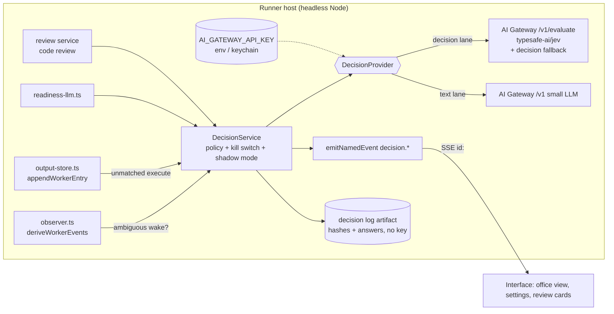
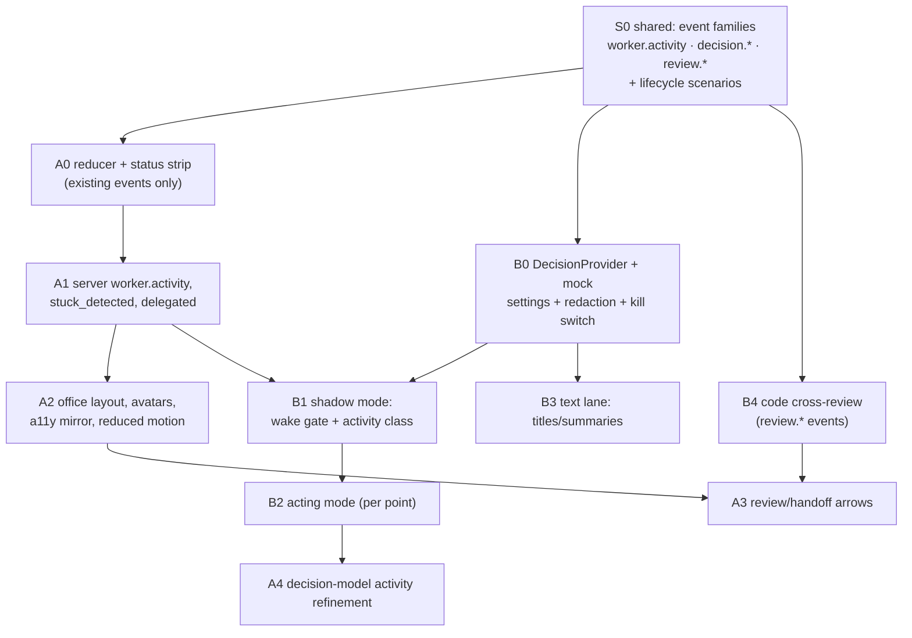

# Research Report: Agent Office View (A) + Vercel Decision Layer and Codex↔Claude Cross-Review (B)

Date: 2026-10-07 · Status: research + recommended plan. **Nothing is implemented yet.**
Labels: **[F]** fact with a citation · **[I]** inference · **[R]** recommendation · **[U]** unverified.

---

## 0. Summary of recommendations

1. **"jev agent" means TypeSafe AI's Jev decision model (`typesafe-ai/jev`)**, served by Vercel AI Gateway at `POST /v1/evaluate` and authenticated with an AI Gateway API key [F §B1]. It returns typed Choice/Score/Boolean answers with probabilities. It does not generate text.
2. **[R] Build one server-side `DecisionService` with two lanes.** The *decision lane* sends typed questions to Jev and escalates through Gateway "decision fallbacks". The *cheap-text lane* uses a Gateway LLM for titles and summaries. Every call emits named events.
3. **[R] Ranked decision points:** (1) the supervisor wake gate (`shouldWakeSupervisor`), (2) worker activity classification, which also drives the office avatars, (3) advisory stuck/looping detection, (4) plan-readiness pre-screening, (5) title and summary generation in the text lane. **Never** let the cheap model approve permissions or take destructive actions.
4. **[R] The API key lives only on the runner host.** It goes in the env/`.env` or the OS keychain. It is never in `sqlite.db`, never in worker JSONL or events, and never sent to clients. Redaction gains the `vck_` prefix.
5. **[R] Office view stack: plain React + one Canvas2D layer** (the Pixel Agents pattern), driven by a pure `AgentActivity` reducer that runs on events the system already has. Skip PixiJS and Phaser for the MVP.
6. **[R] Shared infrastructure:** add one new server event, `worker.activity`. It feeds both the office view and the decision layer's eval logging. Build it first.
7. **[R] Cross-review:** reuse the planning-review tables and selection logic (`review-agent-selection.ts` already prefers a *different* agent type). Add a code-review mode with structured verdicts, a 3-round cap, and the user as tie-breaker.
8. **[R] Practitioner tools:** Herdr → *adapt* (status vocabulary). Plannotator → *adapt* (guided review ordering). OpenSpec → *adapt*, opt-in for large work. OMP → *adapt* ideas only (model roles, quota balancing). GitHub stacks → *skip* unless you grant an explicit exception to the no-branches rule.
9. **First step A:** a pure `deriveAgentActivity()` reducer plus a static status-board strip. **First step B:** a `decision.*` event family with a shadow-mode wake gate that logs and does not act.

---

## 1. Repository facts this plan relies on

| Fact | Source |
|---|---|
| Run status column is free text (`'running','done','failed'`, plus `awaiting_user` in use) | `src/server/db/schema.ts:47`, `src/server/conversations/sync.ts:1046` |
| Worker status is free text (`idle, working, stuck, cred-exhausted`, plus `starting, recovering, lost, error, cancelled, stopped, completed`) | `src/server/db/schema.ts:132`, `src/server/conversations/direct-run-status.ts:31`, `src/server/supervisor/observer.ts:88-95` |
| `workers.workerRole` exists (values seen: `implementation`, `validation`, `supervisor`) | `src/server/db/schema.ts:135` |
| Typed named-event union with `emitNamedEvent`, ring buffer, SSE `id:` and replay | `src/server/events/named-events.ts:1075-1281` |
| Worker events: `worker.spawned/status/terminal/reattached/recreated/failover_*/handoff_emitted/plan_updated/entry_appended` | `src/server/events/named-events.ts:344-541` |
| ACP events incl. `acp.interaction_requested/resolved`, `acp.provider_turn_started/ended`, `acp.prompt_absorbed` (added by commit 3d8822c) | `src/server/events/named-events.ts:1040-1055`; `src/server/agent-runtime/manager.ts:2382,2431` |
| `error.surfaced` with stable `code`, `surface`, subject ids | `src/server/events/named-events.ts:924-936` |
| Worker stream entry types: bridge (`message, thought, tool_call, tool_call_update, permission, elicitation, plan, usage, …`) and server (`user_input, supervisor_input, system_note, lifecycle`) | `src/shared/worker-entries.ts:25-50` |
| Tool calls carry `toolKind` (ACP kind) | `src/shared/worker-entries.ts:69` |
| Supervisor observer decides `shouldWakeSupervisor` per derived worker event | `src/server/supervisor/observer.ts:81-86,556` |
| Execution-event `eventType` strings (e.g. `worker_prompted`, `direct_worker_awaiting_user`, `clarification_requested`, `worker_turn_completed`) | `grep eventType: src/server`; stuck resolution in `src/lib/worker-stuck-events.ts:7-19` |
| LLM calls today go through Mastra `Agent` + `getSupervisorModelConfig` (default primary `gemini/gemini-3.5-flash`, fallback `openai/gpt-5.4-mini`) for: titles, plan readiness, supervisor, memory consolidation | `src/server/supervisor/model-config.ts:6-9,81-127,172-198`; `src/server/conversation-title.ts:69-108`; `src/server/plans/readiness-llm.ts:121-150`; `src/server/supervisor/memory-consolidation.ts:333` |
| Installed `@mastra/core@1.28.0` already bundles the AI Gateway client and reads `AI_GATEWAY_API_KEY` | `node_modules/@mastra/core/dist/chunk-ULBCXUZL.js` (grep) |
| Package `ai` (AI SDK 7, needed for `experimental_decide`) is **not** a direct dependency | `package.json`, `node_modules/ai` absent |
| Secrets in settings: `*_API_KEY/_TOKEN/_SECRET/_PASSWORD` are AES-256-GCM encrypted in the `settings` table; the key file is `~/.omniharness/settings.key` | `src/server/settings/crypto.ts:9-13,16-62` |
| A handoff redactor exists (covers `sk-…`, `gh*_`, `Authorization:` headers); it does not cover `vck_` | `src/server/handoff/redaction.ts:3-11` |
| Planning review already picks a *different* healthy agent type when `auto` is set | `src/server/planning/review-agent-selection.ts:60-68` |
| Review findings schema: `severity, category, title, details, recommendation, sourcePath` | `src/server/db/schema.ts:553-575` |
| Supervisor tools include `worker_approve/worker_deny/ask_user/mark_complete/mark_failed` | `src/server/supervisor/tools.ts:86-245` |
| Existing frontend activity managers: `SidebarWorkerActivityManager`, `supervisor-activity.ts`, `direct-control-activity.ts`, `WorkerEntriesManager` | `src/interface/home/*` |
| **No `prefers-reduced-motion` handling anywhere in `src/`**, although PRODUCT.md requires reduced motion | grep; `PRODUCT.md:37` |
| PRODUCT.md anti-reference: "Sci-fi command centers … gratuitous motion" | `PRODUCT.md:21-25` |
| `sqlite.db` at the repo app root currently has **0 runs** (it is a stale file from Sep 17) | read-only count via better-sqlite3 |

---

# Part A: "Agent Office" 2D view

## A1. Prior art (accessed 2026-10-07)

| Product | What it shows | Pattern worth taking | Source |
|---|---|---|---|
| **Pixel Agents** (VS Code ext., MIT, pixel-agents-hq) | Pixel office. Each Claude Code terminal becomes a character that types (writing), reads (search), runs commands, and shows a speech bubble while waiting for input or permission. Sub-agents become separate characters. Sound plays when a turn finishes. | Closest analogue to Feature A. State comes from **hook events plus a JSONL transcript fallback**. Rendering is **Canvas2D + React 19 + Vite**. Character art is credited to "JIK-A-4, Metro City", so check that licence separately. | github.com/pablodelucca/pixel-agents (redirects to pixel-agents-hq) [F] |
| **AI Town** (a16z-infra, MIT) | Sim town with speech bubbles | Built on **PixiJS**. Tiles from OpenGameArt (per-asset licences), some art generated via Replicate/Fal. | github.com/a16z-infra/ai-town [F] |
| **Generative Agents / "Smallville"** (Park et al., 2023) | Sim of 25 agents | Shows emoji status above each head as an ambient summary. | paper, 2023 [U: rendering stack not re-verified] |
| **Herdr** (Apache-2.0, v0.9.3) | Multi-machine dashboard with states **working / blocked / idle / done** | A small, honest status vocabulary that works across machines over SSH. | herdr.dev [F] |
| **Claude Code agent teams** (experimental) | The lead's terminal lists teammates and their current task. Shift+Down cycles teammates. Ctrl+T opens a shared task list. | Click-to-focus a teammate; a shared task list as a separate surface from the avatars. | code.claude.com/docs/en/agent-teams [F] |
| **Codex app** (OpenAI) | Parallel threads in worktrees, each with its own terminal | List-first, not spatial. Status sits next to each thread. | developers.openai.com/codex/app/features [F, details summarized by search] |
| **Grok Build parallel agents / Arena** (xAI, beta May 2026) | Up to 8 parallel coding agents; arena compares outputs | Side-by-side comparison of competing outputs. | testingcatalog.com, developersdigest.tech [U: secondary sources only] |
| **Meta Muse Spark "Contemplating"** (Apr 2026) | Parallel reasoning agents merged into one answer | Shows sub-agents as one aggregated answer, not separate avatars. | engadget.com, datacamp.com [U: secondary sources; UI details not verified] |

**[I] Patterns that work:**
1. Ambient status with a single glyph or pose for each agent, readable at a glance without logs.
2. A speech bubble *only* when the user must act (input or permission). Activity never produces one.
3. Click an avatar to focus that worker's existing stream.
4. Sound or notification on turn end and on needs-input, and nothing else.
5. Sub-agents appear as separate, smaller characters linked to their parent.
6. A list/task surface always sits alongside the spatial view.

## A2. State → animation mapping

The reducer reads existing events and stream entries. "Gap" marks a missing driver.

| Avatar state | Animation (reduced-motion equivalent) | Existing driver(s) | Gap? |
|---|---|---|---|
| **spawning** | walk to desk (fade in) | `worker.spawned`, `process.spawned` | — |
| **researching** | reading a book or scrolling (static "reading" icon) | `tool_call` with `toolKind ∈ {read, search, fetch}` | `toolKind` is adapter-dependent → **G1** |
| **thinking** | thought dots | `thought` entries, `acp.provider_turn_started` | — |
| **writing code** | typing (keyboard icon) | `tool_call` with `toolKind ∈ {edit, delete, move}` | — |
| **running tests / commands** | monitor flicker (terminal icon) | `tool_call` `toolKind=execute` | Tests and other commands look the same → **G2** |
| **waiting on user** | raised hand plus speech bubble "?" (static badge, aria-live polite) | `acp.interaction_requested`, `conversation.awaiting_user`, `direct_worker_awaiting_user`, `clarification_requested`, pending `permission`/`elicitation` entries | — |
| **blocked / stuck** | slumped, red "!" (static badge) | worker status `stuck`, `acp.prompt_absorbed`, `recovery.opened`, `stuck-worker-reaper` events | No unified "stuck because X" event → **G3** |
| **quota-blocked** | asleep "zZ" | worker status `cred-exhausted`, `account.quota_exhausted`, `recovery.quota_wait_preserved` | — |
| **handing off** | walks paper to another desk (arrow between avatars) | `worker.failover_started`, `worker.handoff_emitted`, `worker.failover_completed` | Only covers failover handoffs, not supervisor delegation → **G4** |
| **reviewing another agent's work** | magnifier over the other desk (magnifier icon) | `plan.review.started/finished`, planning review rounds | No code-review equivalent → **G5** (Part B) |
| **supervisor deciding** | main avatar at whiteboard | `supervisor.wake_lease_acquired/released` | — |
| **done** | leans back, check mark | `worker.terminal` (status completed), `worker_turn_completed` | — |
| **errored** | red smoke puff (static ✖) | `worker.terminal` (error), `error.surfaced` with `workerId` | — |
| **recovering / reattached** | walks back to desk | `worker.reattached/recreated`, `worker.recovery_continuation_started` | — |
| **idle** | idle loop, throttled (none) | worker status `idle`, `acp.provider_turn_ended` | — |

### Proposed event additions, following the lifecycle-observability rules

1. **`worker.activity`** (G1/G2/G4). Derived on the server at the stream-append boundary, so the UI does not re-derive server decisions (lifecycle doc §1, "lossy snapshot diffs"):
   ```ts
   | { kind: "worker.activity"; runId: string; workerId: string;
       activity: "researching"|"thinking"|"writing"|"testing"|"executing"|"waiting_user"
               |"blocked"|"handing_off"|"reviewing"|"idle";
       prev: string | null;
       source: "tool_kind"|"command_pattern"|"interaction"|"status"|"decision_model";
       targetWorkerId?: string;   // handoff/review counterpart
       entrySeq?: number }        // link to the worker stream
   ```
   Emit it only on *transitions* and debounce to at most 1 per worker per 750 ms. `testing` comes from a deterministic command-pattern table (`vitest|jest|pytest|pnpm test|go test|cargo test`). Ambiguous commands may later be classified by the decision layer, which then sets `source: "decision_model"`.
2. **`worker.stuck_detected`** (G3): `{ runId, workerId, reason: "prompt_absorbed"|"no_output"|"looping"|"reaper", sinceMs }`, paired with an existing `recovery.*` event or a `worker.status` resolution.
3. **`supervisor.delegated`** (G4): emitted by `worker_spawn`/`worker_continue` (`src/server/supervisor/tools.ts:86-117`) as `{ runId, fromWorkerId: "supervisor", toWorkerId, intentPreview }`. The preview passes through `redactHandoffText`.
4. **`review.started/finished/verdict`** (G5) is defined in Part B and shared.

These events carry ids, not transcript bodies. The worker stream stays the only content store (agents.md rule).

## A3. Rendering technology

Bundle sizes are rough min+gz figures from general knowledge **[U]**. Check them on bundlephobia before committing.

| Option | Size | Vite/React fit | Mobile/Capacitor | Electron | A11y | Playwright testability | Verdict |
|---|---|---|---|---|---|---|---|
| **PixiJS v8** (+ `@pixi/react`) | large (~hundreds KB) [U] | good | WebGL; good perf but more battery | fine | canvas → needs a parallel DOM | needs `window.__office` hooks | overkill for ≤50 sprites |
| **Phaser** | largest [U] | poor: its own game loop and scene system fight React managers | heavy | fine | canvas | hard | skip |
| **Konva** (+ react-konva) | medium [U] | good | Canvas2D, ok | fine | canvas | medium | viable alternative |
| **Canvas2D (hand-rolled)** | ~0 | good, as the Pixel Agents precedent shows | best control over pausing | fine | canvas plus DOM mirror | test the reducer, not the pixels | **pick for the floor/sprites** |
| **SVG/CSS + Lottie/Rive** | Lottie/Rive runtimes are medium [U] | good | CSS cheap; Rive WASM | fine | DOM, so good a11y | excellent | good for the *main avatar* only (optional, later) |
| **Plain React + CSS sprites** | ~0 | native fit with existing `Fx` (`src/interface/fx/Fx.tsx`) | cheap; animations pause with `animation-play-state` | fine | best (real DOM, aria) | excellent | **pick for avatars at ≤20; status strip; fallback** |

**[R] Hybrid.** Desks and avatars are absolutely positioned React elements with CSS `steps()` sprite animation, which gives real DOM, focus, aria and easy Playwright selectors. An optional Canvas2D backdrop handles the floor and tiles. Move to PixiJS only if profiling at 50 agents fails.

## A4. Art pipeline

| Option | Pros | Licensing risk |
|---|---|---|
| CC0 packs (e.g. Kenney.nl) [U: verify each pack page] | zero attribution burden | low; still record provenance per file |
| CC-BY / OpenGameArt mixed | lots of choice | **medium**: attribution must ship in the app and docs; per-asset licences differ (AI Town credits several authors) |
| Pixel Agents / Metro City characters | proven look | **high/unknown**: credited to a third party; no reuse without checking that licence |
| AI-generated sprite sheets | custom style | **medium**: provider terms and style-copy risk; output is inconsistent across frames |
| **Procedural pixel avatars, seeded by `hash(workerId)` or `hash(workerType+workerNumber)`** | deterministic, no licence risk, unlimited distinct agents, tiny | low; quality depends on the generator |

**[R]** Use procedural avatars plus a small CC0 tile set. Encode agent type in the silhouette or accessory (e.g. Codex vs Claude vs Gemini), never in colour alone (WCAG, PRODUCT.md). Keep an `ASSET_LICENSES.md` next to the assets.

## A5. Interaction design

- **The main avatar is the supervisor.** Clicking it focuses the existing `ConversationComposer` (`src/components/home/ConversationComposer.tsx`). Attachments (`ComposerAttachmentDraftStore`), queued messages and the plan-review flow (`PlanningReviewControls.tsx`) are **unchanged**; the office is a different *view* of the same managers, not a new input path. A "waiting on you" bubble on any avatar opens the existing inline permission/elicitation control in the main conversation, as the interactive-protocol invariant in the lifecycle doc requires.
- **Click-to-focus a worker** opens that worker's `Terminal` with `entries` from `WorkerEntriesManager`, exactly as `WorkersSidebar` does today.
- **Scaling:**
  - **≤5**: one room.
  - **6–20**: rooms grouped by run/conversation, or by role (implementation / validation / review).
  - **21–50**: collapse idle and done agents into a "break room" counter; render animations only for agents in a non-idle state; offer a pinned "needs you" lane.
  - **>50 or narrow viewport**: switch automatically to the status-board strip (Herdr-style rows: avatar glyph · name · state · duration).
- **Fallback:** a view toggle `office | list`, persisted per viewer in `HomeUiStateManager`. `list` is today's UI, and it is the default on mobile and with reduced motion until the user opts in. All strings go through `t()` with keys under `office.*` in all 9 locale files.
- **Screen readers:** a visually hidden `<ul>` mirrors every avatar ("Worker 3, Claude, writing code, 2 min"). Transitions to `waiting_user`, `blocked` and `errored` are announced through one polite `aria-live` region and rate-limited.

## A6. Performance and cost

- **Event throttling:** coalesce `worker.activity` per worker in a `requestAnimationFrame`-batched manager. Drop intermediate states shorter than 300 ms on the client; the server already debounces.
- **Offscreen pausing:** use `IntersectionObserver` on the office root, `document.visibilityState`, and the Capacitor app pause/resume events (the existing mobile suspension contract closes streams on pause; lifecycle doc "Multi-runner client lifecycle"). With CSS sprites, pausing is a single class toggle.
- **Idle budget:** at most 8 animating avatars at once. Idle loops run at ≤4 fps. No continuous canvas redraw: redraw only on a state change or when a walking tween is active.
- **Battery:** on mobile, animations are off by default (static poses). Honour `prefers-reduced-motion`, which the app does not handle yet (gap noted in §1).

## A7. Module boundaries (proposed paths)

```
src/server/events/named-events.ts            + worker.activity, worker.stuck_detected, supervisor.delegated
src/server/workers/activity-classifier.ts    pure: (entry, prevActivity) -> activity | null   (unit-tested)
src/server/workers/output-store.ts           call classifier after appendWorkerEntry; emit on transition
src/shared/agent-activity.ts                 shared activity union + command-pattern table
src/interface/office/AgentOfficeManager.ts   StateManager: workerId -> {activity, since, seat, room}
src/interface/office/deriveAgentActivity.ts  pure reducer from NamedEvents (+ snapshot bootstrap)
src/interface/office/OfficeView.tsx          React layout (rooms, desks)
src/interface/office/AgentAvatar.tsx         CSS sprite avatar, aria label
src/interface/office/OfficeStatusStrip.tsx   compact Herdr-style board (also the >50 fallback)
src/interface/office/procedural-avatar.ts    seed -> pixel sprite
shared/locales/*.json                        office.* keys (9 files)
tests/server/workers/activity-classifier.test.ts
tests/interface/office/deriveAgentActivity.test.ts
tests/lifecycle/scenarios/worker-activity-events.test.ts
tests/e2e/office-view.spec.ts                (selectors on the DOM mirror)
```

## A8. Risks for A

- **Brand conflict:** PRODUCT.md rejects gratuitous motion. Keep the office opt-in, restrained, with static poses by default.
- **Wrong state looks like a confident state.** Show the activity *source* on hover, and never present a stale snapshot as live (`stream.resync_required` greys the office out).
- **Adapter variance in `toolKind`:** needs a fixture matrix per adapter (Codex, Claude, Gemini, OpenCode).
- **Art licensing:** see A4.

## A9. Phased MVP

1. **A0 (smallest shippable)** — *implemented 2026-10-07*: `src/interface/office/deriveAgentActivity.ts`, `src/interface/office/OfficeStatusStrip.tsx`, wired in `WorkersSidebar` (Active tab, ≥2 workers), `office.*` keys in all locales, tests in `tests/interface/office/`. Tool-kind refinement (`latestToolCall`) is supported by the reducer but not yet fed by the sidebar; that arrives with A1's `worker.activity`. Original scope: `deriveAgentActivity()` reducer over *existing* events and statuses, plus `OfficeStatusStrip` (glyph, state, duration) in the workers sidebar. No art, no new server events.
2. **A1:** server `worker.activity`, `worker.stuck_detected` and `supervisor.delegated` events, with lifecycle scenarios. *Implemented 2026-10-07*, with these deviations from the A2 sketch:
   - `worker.activity` is emitted from `src/server/workers/activity-tracker.ts` at both append boundaries (`writeWorkerOutputEntries`, `stream-writer`), **once per append batch as a net transition** rather than with a time debounce. That avoids timer-owned state, and recovery reconciles don't replay hundreds of stale transitions. The stream-derived vocabulary is `researching | writing | testing | executing | working | waiting_user` (`src/shared/agent-activity.ts`).
   - `worker.stuck_detected` currently has a single reason, `no_output`, emitted by the stuck-worker reaper when it decides to recover. A lost completion does not emit it. `acp.prompt_absorbed` remains its own event (the runtime self-heals it, so it is not "stuck").
   - `supervisor.delegated` fires for `worker_spawn` (after spawn) and `worker_continue` (before the ask). It carries the resolved intervention type and a redacted 160-character preview.
   - Client: `worker.activity` is routed via `LiveEventConnectionManager` → `WorkerActivityManager` (latest per worker, replay-safe by `entrySeq`), and refines "working" in the status strip.
   - Tests: `tests/server/workers/activity-tracker.test.ts`, `tests/lifecycle/scenarios/worker-activity-events.test.ts` (SSE + Last-Event-ID replay), reaper/supervisor/live-event assertions, and `tests/interface/office/*`.
3. **A2:** office layout with procedural avatars and CSS sprites, click-to-focus, the main avatar wired to the composer, the a11y mirror, reduced-motion, and the `office | list` toggle. *Implemented 2026-10-07*:
   - `OfficeView.tsx`, `AgentAvatar.tsx`, `procedural-avatar.ts`, `office-model.ts`, `OfficeViewManager.ts`, `focus-composer.ts` and `activity-icons.ts` under `src/interface/office/`, plus `src/interface/styles/office.css`.
   - Toggle in the workers sidebar, persisted per browser; the **default is `list`**.
   - Avatars are deterministic pixel SVGs, and agent type is shown as an accessory shape: Codex glasses, Claude headphones, Gemini cap, OpenCode bandana.
   - Layout rules: at most 8 animated desks; above 20 workers, resting workers collapse into a break room; above 50 workers, the view falls back to the status strip.
   - Animations stop under `prefers-reduced-motion`, on touch-first devices, while offscreen, and while the page is hidden.
   - **Deviation:** there is no separate screen-reader mirror list. Desks are real buttons whose accessible names carry the full state, plus one polite live region for workers that need attention. A mirror list would duplicate those names.
   - The main desk focuses the composer through `data-composer-input`. It does not yet show supervisor activity, because supervisor events are not plumbed to the client (A3/A4).
4. **A3:** handoff and review arrows, rooms by run, break-room collapse, mobile pause, an optional Canvas2D floor. *Implemented 2026-10-08*, with these deviations:
   - **Relationships are badges, not drawn arrows.** Each desk shows "Reviewing Worker 1", "Took over from Worker 2", "New task from the main conversation", and so on, with a directional icon nudge. Endpoints get a primary-colour border, and the text is part of the desk's accessible name.
     - Drawn SVG arrows would need layout measurement for every grid reflow and would carry no extra information.
     - Relations come from `OfficeRelationsManager`, which is purely event-driven:
       - `supervisor.delegated` and `worker.failover_completed` open a relation; the target's next tool or interaction `worker.activity` closes it.
       - `worker.review_started` opens a relation and `worker.review_finished` closes it.
       - A resync drops all relations.
   - New server events `worker.review_started` / `worker.review_finished` are emitted from plan review (reviewer → planner, including the failure path). Plan reviewers are persisted with `workerRole: "plan_review"`.
   - **Rooms are by role, not by run.** The workers sidebar only ever shows one conversation's workers, so rooms by run would always be a single room. `workerRole` is now in both snapshot serializers. Rooms are main / implementation / validation / review, and they appear only above 5 desks when more than one role is present.
   - Break-room collapse was already done in A2.
   - **Mobile pause:** the app's mobile suspension already relies on `visibilitychange` (`RunnerRegistryProvider`), which the office pause observer uses. Animations are also off on touch-first devices.
   - The optional Canvas2D floor was skipped.
   - Tests: `tests/interface/office/office-relations.test.ts`, `tests/lifecycle/scenarios/plan-review-relations.test.ts`, dispatch/reset in `tests/app/live-event-connection-manager.test.ts`, and room rendering in `tests/ui/office-view.test.tsx`.
5. **A4 (optional):** Rive/Lottie main avatar; `source:"decision_model"` refinement from Part B. *Implemented 2026-10-08*:
   - The `decision_model` refinement landed in B2.
   - **Main desk:** it now shows the supervisor's state from `SupervisorActivityManager`, fed by named events:
     - thinking (`wake_lease_acquired`);
     - will check back (`wake_scheduled` with a delay, excluding lease retries);
     - stopped (`supervisor.stopped`);
     - otherwise idle.
     - Shown as an icon, a text label and the accessible name, plus a pulsing thought bubble. The bubble obeys the existing reduced-motion, touch and pause rules.
     - Direct conversations have no supervisor and stay idle.
   - **Deviations:**
     - CSS animation instead of Rive/Lottie: no new runtime dependency or art pipeline, consistent with A2.
     - Supervisor state is not in the snapshot, so after a load or resync it starts idle and corrects itself on the next supervisor event.
   - Tests: `tests/interface/office/supervisor-activity-manager.test.ts` and event routing in `tests/app/live-event-connection-manager.test.ts`.

---

# Part B: Vercel decision layer + Codex↔Claude cross-review

## B1. What Vercel offers today (official docs, read 2026-10-07)

**Interpretation of "jev agent"** [F]: "Jev" is **TypeSafe AI's "System One" decision model, `typesafe-ai/jev`**, available on Vercel AI Gateway. The changelog dated **2026-09-16** describes it as "a probabilistic decision model for software: state goes in, typed Choice, Score, and Boolean answers come out." It is called with an **AI Gateway API key**. That matches "generate an agent/API key in Vercel" plus a fast, cheap decision model. *Not* to be confused with **Vercel Agent**, the dashboard/PR-review assistant (Pro/Enterprise beta), which is not offered as a general API for external apps (vercel.com/docs/agent, updated 2026-09-18). "eve" (eve.dev) is a separate agent framework that deploys to Vercel and is also unrelated.

| Topic | Fact | Source (last_updated) |
|---|---|---|
| Endpoints | `https://ai-gateway.vercel.sh/v1` (OpenAI Chat Completions + Responses), `https://ai-gateway.vercel.sh` (Anthropic Messages), **`POST /v1/evaluate` (decisions)**, OpenAI-compatible Decisions API, TypeSafe-compatible `/typesafe/v1/systemone` | /docs/ai-gateway (2026-09-14); /docs/ai-gateway/modalities/decision (2026-10-07) |
| Decision API | `model`, `state` (string/object/array), `questions{ id: {type: choice\|score\|boolean, instructions, criteria} }`; answers include `probabilities`/`probability`; several questions per request. AI SDK: `experimental_decide` needs **`ai` ≥ 7.0.128**. Decisions are **not** available through Chat Completions/Responses. | decision modality page (2026-10-07) |
| Decision fallbacks | One conditional object first in `providerOptions.gateway.models`: `{ model, when: {question, confidenceBelow} \| {probabilityBetween:[lo,hi]} \| any/all/atLeast }`. On a match the **whole decision reruns** on the fallback model. Both stages are billed and latencies add. Missing confidence matches conservatively (`confidence_unavailable`). `routing.modelAttempts[].triggeredBy` explains why. | /docs/ai-gateway/models-and-providers/decision-fallbacks (2026-10-07) |
| Jev pricing/limits | **$0.042 per 1M input tokens**; 32K context; provider TypeSafe AI | vercel.com/ai-gateway/models/jev [F]; output-token pricing not shown → **[U]** |
| Jev performance | "193.6x faster and 444.6x cheaper than LLMs on its workflow evaluations" (TypeSafe's own claim) | changelog 2026-09-16 → vendor claim, **[U]** independently |
| Template threshold | The Jev form-router template accepts at confidence ≥ 0.95 and otherwise falls back to an LLM. Jev timeout 12 s, fallback 25 s. | vercel.com/kb/guide/jev-ai-sdk-form-router (2026-09-21/22) |
| Auth | **Team-scoped API keys** (dashboard, `vercel ai-gateway api-keys create`, or `POST /v1/api-keys` with optional `projectId`, `expiresAt`); OIDC only for Vercel deployments. Keys are shown once and can't be edited (rotate = create + delete). Keys are **deactivated when their creator leaves the team**. Compromised-key endpoint exists; key format `vck_…`. | /docs/ai-gateway/authentication-and-byok/api-keys (2026-09-08) |
| Budgets | Per team/project/API key/member; exceeding one returns **402 `quota_for_entity_exceeded`**; soft caps | api-keys + rate-limits pages |
| Rate limits | **Paid tier: no Gateway limits** (provider limits still apply). Free tier: lower per-model limits. 429 may include `retry-after`. AI SDK `maxRetries` defaults to 2. | /docs/ai-gateway/rate-limits (2026-09-08) |
| Pricing | **Zero markup on tokens** (incl. BYOK); free monthly credit only for free-tier models; paid add-ons: Custom Reporting $0.075/1K writes, team-wide ZDR $0.10/1K req, provider allowlist $0.10/1K req | /docs/ai-gateway/pricing (2026-09-08) |
| Data retention | "AI Gateway uses zero data retention by default"; per-request `providerOptions.gateway.zeroDataRetention: true` restricts routing to ZDR providers (Pro/Enterprise) | /docs/ai-gateway/security-and-compliance (2026-09-08) |
| Observability | Request logs show model, provider attempts, latency, tokens, cost; responses include `providerMetadata.gateway.cost` and `generationId` | overview + decision pages |
| Model fallbacks (text) | `providerOptions.gateway.models: [...]` plus `order`/`only` for providers | model-fallbacks page (2026-10-02) |

## B2. Where a cheap decision model pays off

Frequencies are **[I] estimates** for a typical 1–5-worker session. Measure them with the eval in B6 before relying on them.

| # | Decision point (today) | Lane | Frequency | Latency sensitivity | Cost of a wrong answer | Value rank | Guardrail |
|---|---|---|---|---|---|---|---|
| 1 | **Supervisor wake gate**: `DerivedWorkerEvent.shouldWakeSupervisor` (`observer.ts:81-86`), today heuristic. Each wake is a full supervisor LLM turn. | decision (Boolean `needsSupervisor` + Choice `reason`) | very high (every poll with changed output) | high | **False negative**: a needed intervention is delayed. **False positive**: an extra heavy turn, same as today. | **1** | Only ever *suppress* wakes the heuristic marked ambiguous; never suppress for permission, elicitation, terminal, error or quota events. Watchdog ceiling: force a wake after N suppressions or T minutes. Shadow mode first. |
| 2 | **Worker activity class** for ambiguous `execute` commands and stream bursts (feeds A's `worker.activity`) | decision (Choice) | high | low (display only) | cosmetic | **2** (shared infra) | Deterministic table first; Jev only for unmatched commands; `source:"decision_model"` shown in UI |
| 3 | **Stuck / looping detection** beyond the quiet timer (`manager.ts:2431`) and `stuck-worker-reaper.ts` | decision (Boolean `looping`, Choice `stuckReason`) over the last K entries | medium | medium | False positive could trigger recovery → **advisory only** | **3** | Emit `worker.stuck_detected{reason:"looping"}` as a *suggestion*; recovery still needs the existing deterministic triggers or the user |
| 4 | **Plan-readiness pre-screen** (`readiness-llm.ts:121`, today a full LLM) | decision (Score per rubric item) → escalate | low–medium | medium | A wrong "ready" can start implementation early | 4 | `confidenceBelow 0.8` → decision fallback to the current LLM; `confirm_ready_to_implement` stays with the supervisor/user |
| 5 | **Conversation titles** (`conversation-title.ts:69`), **handoff summaries** (`handoff/target-summarizer.ts:44`), **memory consolidation** (`memory-consolidation.ts:333`) | **cheap-text lane** (Gateway LLM; Jev cannot write text) | medium | low | cosmetic or recoverable | 5 | Current fallbacks remain (`fallbackTitle`) |
| 6 | Cross-review: "is this approval substantive?" (anti-rubber-stamp, B4) | decision (Score) | low | low | Missed rubber stamp | 6 | Only *adds* scrutiny, never removes it |
| 7 | Failure classification for failover (quota/auth/crash/env) from stderr | decision (Choice) | low | medium | Wrong failover target | 7 | Deterministic patterns (`worker.bridge.fatal_stderr`, quota detectors) win; Jev is only a tiebreaker |
| ✖ | **Permission approval** (`worker_approve/deny`, `tools.ts:137-155`), auto-commit/push, deletes | — | — | — | **Destructive** | never | **Hard rule: the decision layer never approves a permission and never triggers a destructive or outward-facing action.** At most it can *sort* the pending list for display. |

## B3. Secure key handling

- **Where it lives [R]:** on the **runner host only**. The runner is a headless Node process that owns the agents (README); Electron, VS Code and mobile are remote clients, so Electron `safeStorage` does not apply to a runner-side key.
  - **Option 1 (default):** `AI_GATEWAY_API_KEY` in the runner environment or `.env`. Mastra's bundled gateway already reads this name.
  - **Option 2:** OS keychain through a native keyring module **[U: choose and vet the package]**.
  - **Current practice to resolve:** settings-panel keys are AES-GCM ciphertext in `sqlite.db` with the key in `~/.omniharness/settings.key` (`crypto.ts:16-62`). Your brief says "never in sqlite.db", which conflicts with that, so it is listed as an open question.
- **Never** written to worker JSONL, `execution_events`, named events, the `/api/events/log` ring, the handoff packets, or any snapshot sent to clients. The settings API returns only `{configured: boolean, last4?: string, source: "env"|"keychain"|"settings"}`.
- **Redaction:** add `/\b(vck_[A-Za-z0-9_-]{8,})\b/g` to `redaction.ts` SECRET_PATTERNS, and apply it to `error.surfaced.message` and `cause` from the decision client (provider error bodies can echo headers). Add a unit test that injects a fake `vck_TESTONLY…` placeholder.
- **Settings UI:** a new "Decision layer" section in `ModelsSettingsPanel.tsx`. It holds provider (Vercel AI Gateway), the decision model id (default `typesafe-ai/jev`), the escalation model, the text-lane model, the ZDR toggle, per-decision-point enable switches, shadow-mode, and a **kill switch**.
- **Failure behaviour:** for each decision point, the fallback is *today's behaviour*:

| Condition | Response | Event |
|---|---|---|
| Missing key | layer disabled | `decision.skipped{reason:"unconfigured"}` (log surface) |
| 401/403 | disable the layer until settings change | `error.surfaced{code:"decision.auth_failed", surface:"banner"}` |
| 402 | budget exhausted; fall back | `error.surfaced{code:"decision.budget_exceeded"}` |
| 429 | honour `retry-after`, at most 2 retries, then fall back | `decision.fallback{reason:"rate_limited"}` |
| Timeout | 3 s for the wake gate, then fall back | `decision.fallback{reason:"timeout"}` |

## B4. Cross-review loop (Codex ↔ Claude)

**What exists:** planning review runs, rounds and findings (`schema.ts:521-575`), reviewer selection that prefers a different agent (`review-agent-selection.ts:60-68`), `plan.review.*` events, and the validation worker role. **Missing:** code-diff review mode, structured verdict with `file:line`, role alternation, loop cap, disagreement surfacing.

**Protocol [R]:**
1. **Roles.** The implementer is the worker that produced the change (e.g. Codex). The reviewer is the *other* healthy type (Claude) via the existing `auto` selection. Roles swap per milestone, not per round, so one model doesn't always have the last word.
2. **Handover packet** (built server-side, stored as an artifact, no new transcript store):
   - `git diff` against `runs.gitBaselineJson`
   - plan item(s) and acceptance criteria
   - test command output
   - implementer's own summary, redacted with `redactHandoffText`
   - **No implementer chain-of-thought**, which reduces anchoring.
3. **Structured verdict** (JSON schema, validated):
   ```json
   { "verdict": "approve" | "request_changes" | "blocked",
     "findings": [{ "severity": "blocker|major|minor|nit", "file": "src/x.ts", "line": 42,
                    "claim": "...", "evidence": "...", "suggestedFix": "..." }],
     "testsRun": ["pnpm test:..."], "confidence": 0.0-1.0 }
   ```
   It maps onto `planning_review_findings` (`severity, category, title, details, recommendation, sourcePath` + new `line`). The table gets a `review_kind: "plan"|"code"` column rather than a parallel table.
4. **Loop:** implementer fixes, reviewer re-reviews **only the delta plus previously open findings**. Cap at **3 rounds**. Exit when the verdict is `approve` with no blocker/major, or when the cap is hit.
5. **Tie-breaking:** if the implementer disputes a finding (`disputed` with a reason) and the reviewer keeps it, the finding is escalated to the **user** as a decision card in the main conversation. A model never breaks the tie. Nothing auto-merges.
6. **Anti-rubber-stamping:**
   - The reviewer must cite at least one `file:line` it inspected, or list the tests it ran, even when approving.
   - An `approve` with zero findings on a diff above a size threshold triggers a decision-lane Score ("substantive review?"). A low score asks for a second pass.
   - Periodically plant a known defect (eval only, never in user runs) to measure the catch rate.
   - Reviewer and implementer must be different worker *types*. "same" is refused for code review.
7. **Events:** `review.started{runId, reviewKind:"code", implementerWorkerId, reviewerWorkerId, round}`, `review.verdict{verdict, blockerCount, majorCount}`, `review.disputed`, `review.escalated_to_user`, `review.finished{outcome}`, `review.blocked{reason}`. These also drive the office "reviewing" animation (G5).

## B5. Model-role routing and usage balancing

| Role | Today | Proposal |
|---|---|---|
| Planning | planner worker (ACP agent) | unchanged |
| Orchestration | supervisor LLM (`SUPERVISOR_LLM_*`) | unchanged; optionally route via the Gateway with `providerOptions.gateway.models` fallbacks [I: Mastra `url` + OpenAI-compatible base URL should work; verify] |
| Cheap decisions | none | **`DECISION_*` settings → Jev** via `/v1/evaluate` |
| Cheap text | same as supervisor | `TEXT_LANE_*` → a Gateway small model |
| Quota balancing | `isWorkerTypeQuotaBlocked`, quota auto-resume, account switch decisions | Extend the existing `account.switch_decision` signal into worker-type selection: prefer the type with the most remaining quota (from `account_usage_snapshots`) when the user selected "auto" |
| Compaction | provider-side | **Defer.** Compacting locally when the cache is cold and remotely while it is warm needs provider cache-TTL telemetry, which OmniHarness doesn't have. Revisit after B6 metrics exist. |

**Architecture**



**Provider-adapter interface (sketch)**

```ts
// src/server/decisions/types.ts
export type DecisionQuestion =
  | { type: "boolean"; instructions: string; criteria?: { true: string; false: string } }
  | { type: "choice"; instructions: string; criteria: Record<string, string> }
  | { type: "score"; instructions: string; criteria: string[] };

export interface DecisionRequest<Q extends Record<string, DecisionQuestion>> {
  point: DecisionPointId;            // "supervisor_wake" | "worker_activity" | ...
  runId?: string; workerId?: string;
  state: unknown;                    // already redacted + size-capped (Jev context is 32K)
  questions: Q;
  escalation?: { model: string; when: unknown };   // Gateway decision-fallback condition
  timeoutMs: number;
}
export interface DecisionResult { answers: Record<string, unknown>; model: string;
  escalated: boolean; triggeredBy?: { question: string; reason: string }[];
  usage: { inputTokens: number; outputTokens: number }; costUsd?: number; latencyMs: number; }

export interface DecisionProvider {
  id: "vercel-ai-gateway" | "mock";
  decide<Q extends Record<string, DecisionQuestion>>(req: DecisionRequest<Q>, signal: AbortSignal): Promise<DecisionResult>;
  generateText?(req: { point: DecisionPointId; prompt: string; maxTokens: number }, signal: AbortSignal): Promise<{ text: string; model: string }>;
}
```

**[R]** Implement `vercel-ai-gateway` with plain `fetch` to `/v1/evaluate`. That avoids adding `ai@7` just for `experimental_decide`, keeps the request shape explicit in tests, and keeps a `mock` provider for `MOCK_LLM=true`.

**New events** (`DecisionEvent` union in `named-events.ts`):
- `decision.requested{point, runId?, workerId?, requestId}`
- `decision.answered{point, requestId, model, escalated, latencyMs, costUsd?}`
- `decision.fallback{point, reason:"timeout"|"rate_limited"|"budget"|"error"|"disabled"}`
- `decision.overridden{point, by:"guardrail"|"watchdog"|"user"}`
- `decision.skipped{reason}`
- new `SurfacedErrorCode`s: `decision.auth_failed`, `decision.budget_exceeded`, `decision.provider_failed`

## B6. Evaluation

- **Metrics per decision point:**
  - p50/p95 latency vs. the baseline path
  - tokens and $ (from `providerMetadata.gateway.cost`)
  - **escalation rate** (`escalated`)
  - **wrong-decision rate** against labels
  - **downstream effect:** for the wake gate, supervisor turns saved per run and time-to-intervention on wakes that mattered
- **Offline eval set:**
  - **Fact:** the repo-root `sqlite.db` has 0 runs. Build the set from a runner with real history (your main install's app root), exported read-only.
  - **Wake gate:** each historical `DerivedWorkerEvent` with the following supervisor action (did the supervisor do anything non-trivial after waking?) becomes the label.
  - **Activity:** `tool_call` entries labelled by hand (~200).
  - **Stuck:** `recovery_incidents` and the `acp.prompt_absorbed` episodes.
  - Target 200–500 items per point. Strip paths and secrets with `redactHandoffText`. Store as `tests/fixtures/decision-eval/*.jsonl`. Run with `pnpm test:decision-eval` (new) against `mock` in CI and against the live Gateway manually.
- **Shadow mode:** for two weeks of normal use, the decision layer answers but does not act. Compare with the heuristic. Promote a decision point to "acting" only when its wrong-decision rate on the "suppress" side is below an agreed threshold (proposed ≤1% for the wake gate).

## B7. Cost estimate [I]

- Jev input: $0.042 / 1M tokens [F]. Output-token price **[U]**; the docs example shows 20 output tokens per request and a total cost of $0.00001155 for 275 input tokens, which is consistent with input-only pricing.
- Assume 1,500 input tokens per decision and **5,000 decisions/day** (heavy multi-worker use) → 7.5M tokens/day → **≈ $0.32/day** (≈ $9.50/month) before escalation.
- Escalation cost = `escalationRate × decisions × fallbackPricePerCall`. Fallback prices come from the Gateway model page; **not estimated here, to avoid inventing numbers**. At a 10% escalation rate the fallback model dominates spend.
- Net saving comes from suppressed **supervisor turns**. If the wake gate avoids even a handful of full supervisor turns per day, it pays for itself [I], but this must be measured in shadow mode.

## B8. Rollout with kill switch

1. **B0:** `DecisionEvent` types, `DecisionProvider` + mock, settings section (unconfigured = disabled), redaction pattern, `decision.*` lifecycle scenario. *Implemented 2026-10-08*:
   - **Server modules:**
     - `src/server/decisions/` (types, config, `vercel-gateway-provider.ts` using plain `fetch` to `POST /v1/evaluate`, `mock-provider.ts`, `service.ts`).
     - `src/shared/decision-layer.ts` for keys, points and env-only secrets.
   - **Key storage:** the API key is **env-only** (`AI_GATEWAY_API_KEY`):
     - The settings API rejects it with `env_only_setting`.
     - Runtime settings hydration and both settings read paths ignore any stray row.
     - Clients only see `{gatewayKeyConfigured, gatewayKeySource}`.
   - **Service guardrails:**
     - Kill switch `DECISION_LAYER_ENABLED`, default off.
     - Shadow mode, default on.
     - Per-point enablement (`DECISION_POINTS`); no points are wired yet, so the UI does not show per-point toggles.
     - State redaction and a 48K-character cap; a timeout via `AbortSignal`.
     - An auth failure blocks that key, with one `error.surfaced` (`decision.auth_failed`, banner) until the key changes; an exhausted budget is surfaced once (`decision.budget_exceeded`).
     - `decision.skipped` is emitted only when the skip reason changes.
   - **Settings UI:** a "Decision layer" section under Models.
   - **Fixed a pre-existing redaction leak in `src/server/handoff/redaction.ts`:**
     - Bare `sk-…`/`gh*_…` tokens were kept with `[REDACTED]` appended, because the replacer treated the captured token as a "prefix".
     - Patterns without a capture group received the match offset as their "prefix".
     - Regression test added.
   - Tests: `tests/server/decisions/*`, `tests/lifecycle/scenarios/decision-layer-events.test.ts`, settings route and runtime-settings guardrails, `tests/ui/decision-layer-settings.test.tsx`.
2. **B1:** shadow mode for the wake gate and activity classification (log only). *Implemented 2026-10-08*:
   - **`src/server/decisions/shadow.ts`:**
     - Fire-and-forget: it never throws into the caller and never acts.
     - Sampled per key, and the sampled-out count is carried into the next record.
     - Emits `decision.shadow_compared` and appends a JSONL line to `<appRoot>/decision-log/YYYY-MM-DD.jsonl`, which is gitignored. Records hold ids, labels, confidence, model and cost; never state or commands.
     - A failed write emits `decision.log_failed` with a redacted reason.
   - **Point `supervisor_wake`** (`points/supervisor-wake.ts`), hooked after each worker's events in `pollRunWorkers` (`observer.ts`):
     - Compares whether the observer woke the supervisor with Jev's boolean `needsSupervisor`.
     - Every wake is compared; no-wake polls are sampled at most once per 30 s per worker.
   - **Point `worker_activity`** (`points/worker-activity.ts`), hooked in `observeWorkerActivity`:
     - Compares the deterministic test-command pattern (`testing` / `executing`) with Jev's choice for the latest `execute` tool call in a batch.
     - Sampled at most once per 15 s per worker.
   - **Settings UI:** per-point toggles. The shadow-mode switch was replaced by a plain statement, because turning shadow mode off would do nothing until B2.
   - **Report:** `pnpm decisions:shadow-report [--days N]` prints per-point agreement, confusion counts, mean confidence on disagreements, escalations and cost.
   - Tests: `tests/server/decisions/shadow.test.ts` (including real wiring: settings rows → output store → tracker → shadow → service with mock provider → log file) and `tests/supervisor/observer-decision-shadow.test.ts`.
3. **B2:** acting mode for activity classification (cosmetic), then for the wake gate behind its per-point toggle with the watchdog ceiling. *Implemented 2026-10-08*:
   - **Per-point acting** via `DECISION_ACTING_POINTS`. It replaces the global shadow flag and only counts for enabled points. `DecisionService.pointMode()` reports off / shadow / acting without a model call.
   - **`worker_activity` acting:**
     - A confident disagreement (confidence ≥ 0.8) re-emits `worker.activity` with `source: "decision_model"`.
     - It applies only through `refineWorkerActivity`, which refuses unless that command's entry seq is still the worker's current activity.
     - Display only.
   - **`supervisor_wake` acting** — deviation from "suppress": wakes are **deferred by 2 minutes, never dropped**.
     - Why: the observer marks idle and completion hints as already notified, so a dropped wake might never be raised again, and a finished turn also blocks the stuck check.
     - Deferral goes through `scheduleSupervisorWake`, which keeps the earliest deadline and has a durable backup, so any real event still wakes immediately.
     - Deferral is considered only when every wake reason carries `wakeCertainty: "heuristic"`: idle silence, or a long final-looking text turn. It never applies to permissions, questions, errors, stops, stuck workers, or ACP turn ends.
     - The decision is awaited only in acting mode, with a 3 s timeout. Only P(needs supervisor) ≤ 0.2 defers.
     - Watchdog: after 3 consecutive deferrals or 5 minutes, it forces an immediate wake (`decision.overridden`). The streak resets on any real wake.
   - **Events and records:**
     - `decision.acted` (`deferred_wake` / `refined_activity`).
     - The `supervisor_wake_deferred` execution event appears in the run history.
     - Log records gain `acted`, and the report shows it.
   - **Settings UI:** an "Allow to act" switch per point, disabled unless the point is enabled, stating that point's limits.
   - Tests: `tests/server/decisions/acting.test.ts`, deferral wiring in `tests/supervisor/observer-decision-shadow.test.ts`, UI tests.
4. **B3:** cheap-text lane for titles and summaries. *Implemented 2026-10-08* for **conversation titles only**:
   - **Settings:**
     - `DECISION_TEXT_MODEL` has no default; the lane is off until you pick a model, so no model name is hard-coded.
     - `DECISION_TEXT_TASKS` (`["conversation_title"]`) lists which tasks may use the lane.
   - **Plumbing:**
     - `DecisionService.generateText` has the same guardrails and `decision.*` events as decisions (target = text task id).
     - The provider calls AI Gateway's OpenAI-compatible `/v1/chat/completions`.
   - **Titles:**
     - `generateConversationTitle` tries the lane first.
     - Lane titles pass the existing agent-title checks (prompt leak, length, prompt echo) plus an 80-character cap; a rejection is reported as `conversation.title_rejected` with source `decision_text_lane`.
     - Anything else falls through to the existing supervisor-model path unchanged.
   - **Out of scope:**
     - Handoff summaries deliberately use the target agent itself (`handoff/target-summarizer.ts`).
     - Memory consolidation already has its own custom model profile (`SUPERVISOR_MEMORY_LLM_*`).
   - Tests: `tests/server/decisions/text-lane.test.ts` and a settings UI test.
5. **B4:** code cross-review mode on top of planning review. *Implemented 2026-10-08*, with deviations:
   - **Own tables, not a `review_kind` column.** `code_reviews`, `code_review_rounds` and `code_review_findings` (with file/line, status and dispute reason) are separate, because the conversation UI treats `reviewRuns[0]` as the latest plan review and plan-review refresh/blocking treats any running row as a plan review.
     - They cascade on run delete and are deleted explicitly in the delete route and in `scripts/delete-conversations.sh`.
   - **The reviewer is an ephemeral read-only helper agent, not a conversation worker.**
     - Direct conversations are pinned to one CLI type by the `HANDOFF_REQUIRED` trigger, so a Claude reviewer cannot be a worker in a Codex conversation without weakening that invariant.
     - Same pattern as the handoff summarizer. Each round stores the reviewer's final reply (redacted, 8K) in `response_excerpt`.
     - Office review badges therefore don't render for code reviews (no reviewer desk).
   - **Flow** (`src/server/review/code-review.ts`):
     - Start checks: implementer resolution; a live, idle implementer; a different healthy agent type ("same" is refused); a git repo; and non-empty changes. Each refusal is a typed result (`200 {ok:false, refused}`) plus `code_review.refused`.
     - Each round: diff against the run baseline (`diff.ts`, redacted, 60K cap), a strict zod verdict, and an evidence rule (approval needs files inspected, tests run, or located findings; one retry each for format and evidence).
     - Findings go to the implementer as a `supervisor_input`; the implementer replies with a JSON `disputes` block.
     - A dispute the reviewer keeps open is escalated to the user. There are at most 3 rounds, and nothing is committed or merged.
     - Orphaned reviews are closed as `interrupted_by_restart`.
   - **Events:** `code_review.started/refused/round_finished/findings_disputed/finished`, plus `worker.review_started/finished` with `reviewKind: "code"`.
   - **API:** `GET/POST /api/runs/:id/code-reviews`. Client: the `runtime-api` `codeReviews` domain, `CodeReviewUiManager`, and `CodeReviewPanel` in the workers sidebar.
   - **Not done in B4:** decision-layer "substantive review?" scoring; automatic review after milestones (open question 4; on demand only); and recovering an implementer agent that is not running (the user must resume it first).
   - **Found a pre-existing gap:** `error.surfaced` has no client consumer (not in the stream allowlists), so server "banners/toasts" never reach the UI. The panel shows outcomes itself.
6. **Kill switch:** a global `DECISION_LAYER_ENABLED=false` (setting + env) plus per-point toggles. Flipping it emits `decision.skipped{reason:"disabled"}` and every point reverts to today's code path *in the same process* without a restart.

---

## C. Practitioner workflow ideas: adopt / adapt / skip

| Tool | Verified (site, 2026-10-07) | Unverified claims | Verdict | Why |
|---|---|---|---|---|
| **OMP (omp.sh)** | Rust-core coding agent/harness, Windows-native; landing page lists model roles, provider balancing, local compaction, skills chaining, memory extraction, rollback; many providers | Repo, licence and dates not shown; "time travel with summary of what went wrong" not verified | **Adapt (ideas only)** | Model roles map to B5. Quota-aware balancing extends the existing quota code. Rollback overlaps git, and OmniHarness forbids branches, so a "rollback summary" would be a `system_note` plus a git reset proposal that needs user confirmation. |
| **Herdr (herdr.dev)** | Apache-2.0 background server for agent terminal sessions; states working/blocked/idle/done; SSH remotes; multi-machine dashboard; v0.9.3 | "Remote workboxes" naming not seen | **Adapt** | Use its 4-state vocabulary as the coarse layer of A's state table. Multi-runner support already exists in OmniHarness (`RunnerConnection`). |
| **OpenSpec (openspec.dev)** | MIT, `@fission-ai/openspec` v1.13.0; `/opsx:explore → propose → apply → verify → archive`; `openspec/` folder with proposal/design/tasks | Adoption stats are self-reported | **Adapt (opt-in)** | The planning phase (`runs.phase='planning'`, readiness verdicts) already plays this role. Offer an "OpenSpec mode" preset that writes `openspec/changes/*` artifacts and adds a "grill me" clarification round. Too slow as the default. |
| **GitHub stacked PRs (gh.io/stacks)** | Preview; uses the `gh stack` CLI extension; small dependent PRs reviewed and merged independently | Branch mechanics not confirmed on the fetched page, but stacks inherently need one branch per layer **[I]** | **Skip** unless you grant an exception | `agents.md` forbids creating branches. Alternative that keeps the rule: split agent output into **sequential intent-scoped commits on the current branch**, each with its own cross-review round (B4), and list them as a "stack" in the UI. |
| **Plannotator (plannotator.ai)** | MIT/Apache-2.0, local; plan and diff review with line annotations returned to the agent as structured feedback; **"Guided Review"**: an agent reorders the changeset into chapters by importance | That a *small* model builds the path is not stated; it says "an agent" | **Adapt** | Feed the cross-review UI with a decision-lane Score per file ("risk") plus a text-lane chapter summary. Reuse its idea of returning `file:line` annotations as structured feedback (B4 verdict schema). Consider integrating Plannotator directly rather than rebuilding it. |

---

## D. Combined roadmap and shared infrastructure



**Shared infrastructure:**
- The `worker.activity` event is consumed by the office and also produces labels for the decision-layer eval.
- `review.*` events drive both the cross-review cards and the office "reviewing" pose.
- Both features need the same discipline: server-derived named events with `id:` and replay, rather than client snapshot diffing.

---

## E. Top 5 risks

1. **The wake gate suppresses a needed intervention.** Mitigation: suppress only ambiguous events, a watchdog ceiling, shadow-mode metrics first, a kill switch.
2. **Key leakage** through provider error bodies, logs, or settings snapshots sent to remote clients. Mitigation: runner-only key, `vck_` redaction, settings API returns `configured` only, a test with a placeholder key.
3. **Vendor and claim risk.** Jev is new (2026-09-16), the speed and cost claims are the vendor's own, and API keys are deactivated when their creator leaves a Vercel team. Mitigation: the provider interface, deterministic fallbacks, an owner-agnostic key.
4. **The office view contradicts the brand** (gratuitous motion) or misleads by showing stale state as live. Mitigation: opt-in, static by default, greyed on resync, source shown on hover.
5. **Cross-review loops and mutual rubber-stamping** burn quota. Mitigation: 3-round cap, delta-only re-review, evidence requirement, different agent types, the user breaks ties.

## F. Open questions (max 5)

1. **Key storage:** your brief says "never in `sqlite.db`", but settings secrets are stored there today as AES-GCM ciphertext. Should the gateway key be **env/`.env` only** (recommended), or is encrypted settings acceptable?
2. Is your Vercel team on the **paid** AI Gateway tier? Free tier has per-model rate limits and only free-tier models, and team-scoped ZDR needs Pro/Enterprise.
3. Can you confirm "jev agent" = **TypeSafe's Jev decision model on AI Gateway**, rather than a custom agent you deployed on Vercel (e.g. with eve)? If it's the latter, please share its endpoint shape.
4. For cross-review, do you want **automatic** review after every implementation milestone, or **on demand** only?
5. GitHub stacked PRs require branches. Do you want to grant an **explicit exception** to the no-branches rule for this, or keep the "sequential commits on the current branch" alternative?

## G. Smallest first step

- **Feature A:** add `src/interface/office/deriveAgentActivity.ts`, a pure reducer from existing named events and worker statuses to the A2 state vocabulary, with unit tests. Render it as an `OfficeStatusStrip` row inside `WorkersSidebar` (i18n keys in all 9 locales; run `pnpm build:interface:web`). No art and no server changes.
- **Feature B:** add the `DecisionEvent` union plus a `DecisionProvider` with `vercel-ai-gateway` and `mock` implementations, and wire **only** the supervisor wake gate in **shadow mode**. It logs `decision.requested/answered/fallback` alongside the heuristic's choice and never changes behaviour. Add a `tests/lifecycle/scenarios/decision-shadow.test.ts` using the mock provider.

---

### Sources (accessed 2026-10-07)

- Vercel AI Gateway overview (updated 2026-09-14): https://vercel.com/docs/ai-gateway
- API keys (2026-09-08): https://vercel.com/docs/ai-gateway/authentication-and-byok/api-keys
- Rate limits (2026-09-08): https://vercel.com/docs/ai-gateway/rate-limits
- Pricing (2026-09-08): https://vercel.com/docs/ai-gateway/pricing
- Security & compliance (2026-09-08): https://vercel.com/docs/ai-gateway/security-and-compliance
- Model fallbacks (2026-10-02): https://vercel.com/docs/ai-gateway/models-and-providers/model-fallbacks
- Decision fallbacks (2026-10-07): https://vercel.com/docs/ai-gateway/models-and-providers/decision-fallbacks
- Decision modality (2026-10-07): https://vercel.com/docs/ai-gateway/modalities/decision
- Jev changelog (2026-09-16): https://vercel.com/changelog/typesafe-ai-jev-now-available-on-ai-gateway
- Jev model page: https://vercel.com/ai-gateway/models/jev
- Jev form-router guide (2026-09-21/22): https://vercel.com/kb/guide/jev-ai-sdk-form-router
- Vercel Agent (2026-09-18): https://vercel.com/docs/agent
- eve on Vercel: https://eve.dev/docs/guides/deployment/vercel
- Herdr: https://herdr.dev · OMP: https://omp.sh · OpenSpec: https://openspec.dev · Plannotator: https://plannotator.ai, https://docs.plannotator.ai/learn/local-diff-review-for-coding-agents
- GitHub stacked PRs: https://docs.github.com/en/pull-requests/how-tos/stacked-pull-requests
- Pixel Agents: https://github.com/pablodelucca/pixel-agents · AI Town: https://github.com/a16z-infra/ai-town
- Claude Code agent teams: https://code.claude.com/docs/en/agent-teams
- Codex app features: https://developers.openai.com/codex/app/features
- Grok Build parallel agents [secondary]: https://testingcatalog.com/xai-tests-parralel-agents-and-arena-mode-for-grok-build
- Meta Muse Spark [secondary]: https://engadget.com/ai/metas-muse-spark-model-brings-reasoning-capabilities-to-the-meta-ai-app-161456684.html
